  &nbsp;
  &nbsp;
  

  Bots, automatización, servidores y experiencias web: piezas concretas que funcionan en producción.

## Ingeniería en movimiento

<a href="https://pablo2611.github.io/pablo2611/"><picture>
  <source media="(max-width: 650px)" srcset="https://raw.githubusercontent.com/pablo2611/pablo2611/main/assets/dashboard-mobile-ddea6aedb518.svg" />
  
</picture></a>

 
 

<a href="https://github.com/pablo2611?tab=overview"><picture>
  <source media="(max-width: 900px)" srcset="https://raw.githubusercontent.com/pablo2611/pablo2611/main/assets/activity-heatmap-mobile.svg?v=1794890470878" />
  
</picture></a>

## Experiencias interactivas

&nbsp;

## Stack y proyectos

| Área | Enfoque |
| --- | --- |
| **Linux / VPS** | SSH, Docker, Nginx; despliegue, logs y monitorización. |
| **Python** | Backends asíncronos, tareas, colas y procesos persistentes. |
| **Telegram bots** | Bot API, webhooks, conversaciones, comandos y notificaciones. |
| **APIs de IA** | Contexto, herramientas e integración con servicios externos. |
| **Flujos / n8n** | Eventos, webhooks y automatización entre aplicaciones. |
| **Web interactiva** | React, TypeScript y Three.js; diseño, movimiento y rendimiento. |

| Proyecto | Qué es |
| --- | --- |
| **[VerbaLoop](https://github.com/pablo2611/verbaloop)** | Práctica bilingüe de vocabulario con retos, glosario y guía de aprendizaje. |
| **[ServerDock](https://github.com/pablo2611/serverdock)** | Prototipo bilingüe de panel para VPS con TypeScript y FastAPI. |
| **[IG · Quién no me sigue](https://github.com/pablo2611/ig-no-me-siguen)** | Extensión para revisar conexiones y comparar exportaciones locales de Instagram. |
| **[YTDownloader](https://github.com/pablo2611/ytdownloader)** | Herramienta Python de línea de comandos para descargar vídeo o extraer audio. |
| **[AERION](https://github.com/pablo2611/aerion)** | Demo web de conducción 3D con personalización de color y sonido. |
| **[Otro Plano](https://github.com/pablo2611/otro-plano)** | Demo web de escultura digital, diseño 3D y cine. |
