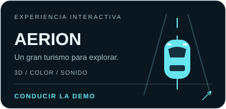
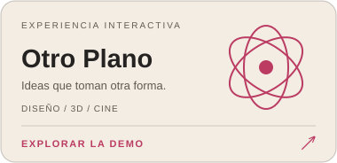

<a href="https://github.com/pablo2611?tab=repositories">Ver proyectos</a> · <a href="https://pablo2611.github.io/pablo2611/">Explorar mi dashboard</a>

 

## Ingeniería en movimiento

<a href="https://pablo2611.github.io/pablo2611/"><picture>
  <source media="(max-width: 650px)" srcset="assets/dashboard-mobile.svg?v=1793125290763" />
  
</picture></a>

<a href="https://pablo2611.github.io/pablo2611/">Abrir las cards en pantalla completa ↗</a>

<strong>Ver el stack y el enfoque</strong>

| Área | Enfoque |
| --- | --- |
| **Linux / VPS** | SSH, Docker, Nginx; despliegue, logs y monitorización. |
| **Python** | Backends asíncronos, tareas, colas y procesos persistentes. |
| **Telegram bots** | Bot API, webhooks, conversaciones, comandos y notificaciones. |
| **APIs de IA** | Contexto, herramientas e integración con servicios externos. |
| **Flujos / n8n** | Eventos, webhooks y automatización entre aplicaciones. |
| **Web interactiva** | React, TypeScript y Three.js; diseño, movimiento y rendimiento. |
| **[VerbaLoop](https://github.com/pablo2611/verbaloop)** | Práctica bilingüe de vocabulario con retos, glosario y guía de aprendizaje. |
| **[ServerDock](https://github.com/pablo2611/serverdock)** | Prototipo bilingüe de panel para VPS con TypeScript y FastAPI. |
| **[IG · Quién no me sigue](https://github.com/pablo2611/ig-no-me-siguen)** | Extensión para revisar conexiones y comparar exportaciones locales de Instagram. |
| **[YTDownloader](https://github.com/pablo2611/ytdownloader)** | Herramienta Python de línea de comandos para descargar vídeo o extraer audio. |

 

  <a href="https://github.com/pablo2611?tab=overview"><picture>
    <source media="(max-width: 900px)" srcset="https://raw.githubusercontent.com/pablo2611/pablo2611/main/assets/activity-heatmap-mobile.svg?v=1793125290763" />
    
  </picture></a>

 

## Experiencias interactivas

  
  

  <a href="https://pablo2611.github.io/aerion/">Conducir AERION ↗</a> · <a href="https://github.com/pablo2611/aerion">Código de AERION</a> 
  <a href="https://pablo2611.github.io/otro-plano/">Explorar Otro Plano ↗</a> · <a href="https://github.com/pablo2611/otro-plano">Código de Otro Plano</a>

---

**Desde Panamá.** Disponible para construir herramientas, bots e integraciones útiles.

  Actividad real obtenida de GitHub. La tarjeta se actualiza cada seis horas; GitHub puede tardar en contabilizar los commits recientes.

